We offer hands-on training on best practice methods and technologies to make research more open, reproducible and transparent. Our **courses and workshops** are centred around the life-cycle of data from planning, managing, collecting, curating, analysing, publishing, storing, sharing and reusing data. They are aimed at PhD students as well as early-career researchers in ecology, who produce their own data (i.e. collect data in the field/lab), use data from others (i.e. databases) or both.

```{=html}
<style>
.photo-gallery {
  display: grid;
  grid-template-columns: repeat(auto-fit, minmax(220px, 1fr));
  gap: 0.85rem;
  margin: 1.1rem 0 1.4rem;
  align-items: start;
}
.photo-gallery.featured {
  grid-template-columns: 1fr;
}
.photo-gallery.featured + .photo-gallery {
  margin-top: -0.35rem;
}
.photo-gallery p,
.photo-gallery figure,
.photo-gallery .quarto-figure {
  margin: 0;
}
.photo-gallery img {
  display: block;
  width: 100%;
  height: 14rem;
  object-fit: cover;
  border-radius: 10px;
}
.photo-gallery.featured img {
  height: 22rem;
}
.photo-gallery figcaption,
.photo-gallery .quarto-figure figcaption {
  margin-top: 0.35rem;
  font-size: 0.9rem;
  line-height: 1.35;
}
@media (max-width: 640px) {
  .photo-gallery img,
  .photo-gallery.featured img {
    height: 12.5rem;
  }
}
</style>
```

## Upcoming courses and workshops

**Workshop at NØF conference in Bergen, 9. February 2027\
**Workshop on Reproducible Research Workflows: A hands-on workshop on Quarto, GitHub, and renv. The workshop is organized by Aud Halbritter and Richard Telford from the University of Bergen.\
Sign up for the workshop [here](https://nordicsocietyoikos.glueup.com/event/oikos-norway-2027-in-bergen-190260/workshops.html).

**Bio940 course on Open, Reproducible and Transparent Science, October 2027\
**More information on the course will be published at the [UiB course pages](https://www4.uib.no/en/studies/courses/bio940) and the [UiB Terrestrial Ecology](https://www4.uib.no/en/research/research-groups/terrestrial-ecology) pages.

## Participants statistics

```{r}
#| echo: false
#| message: false
#| warning: false
source("R/participant_stats.R")
participant_stats("data/student_stats.xlsx")
```

## Past courses and workshops

### Course - Finse, 2026

After three years in Hjerkinn, we went back to the research station at Finse for the Open Scicence course in October 2026 (19. - 24. October 2026). We had 18 students participating in the course of which 14 were PhDs. The international group was from research institutions in Norway, Iceland, Finnland, UK, Austria, and Germany.

The weather was sunny with blue sky, when we arrived at Finse. Soon after the arrival we dived into the data life cycle and the students learned about Open Science, reproducible documents, version control, making R functions and packages, GBIF data, data publishing, using AI, data handling, reproducible workflows and environments, best practice in data analysis and reporting results, fair by design. We had lectures and mostly practical exercises. Besides learning about open and reproducible science, we went on a hike, played games in the evening, and enjoyed the sauna. We also had to prepare the food, do the dishes, and clean the place before leaving.

Tired and satisfied after a week of intense coding and learning a lot of new skills, we left Finse. Thank you for the wonderful week!

::: {.photo-gallery .featured}
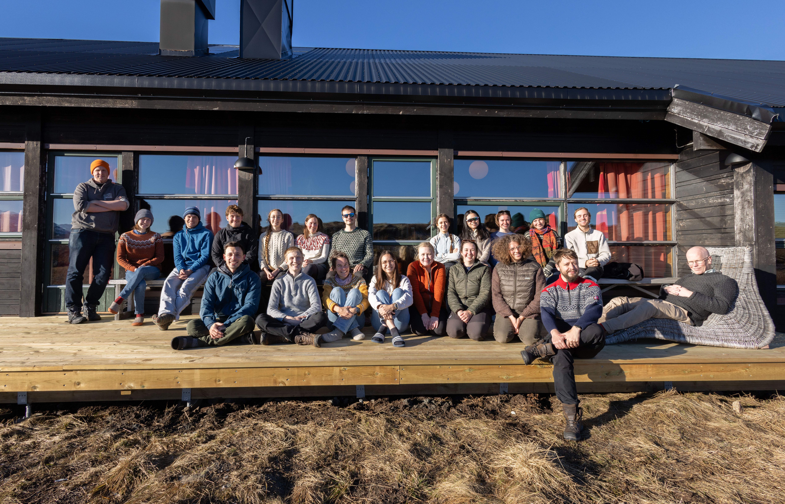{fig-alt="About twenty course participants posing together on a wooden deck outside the Finse research station on a sunny day."}
:::

::: photo-gallery
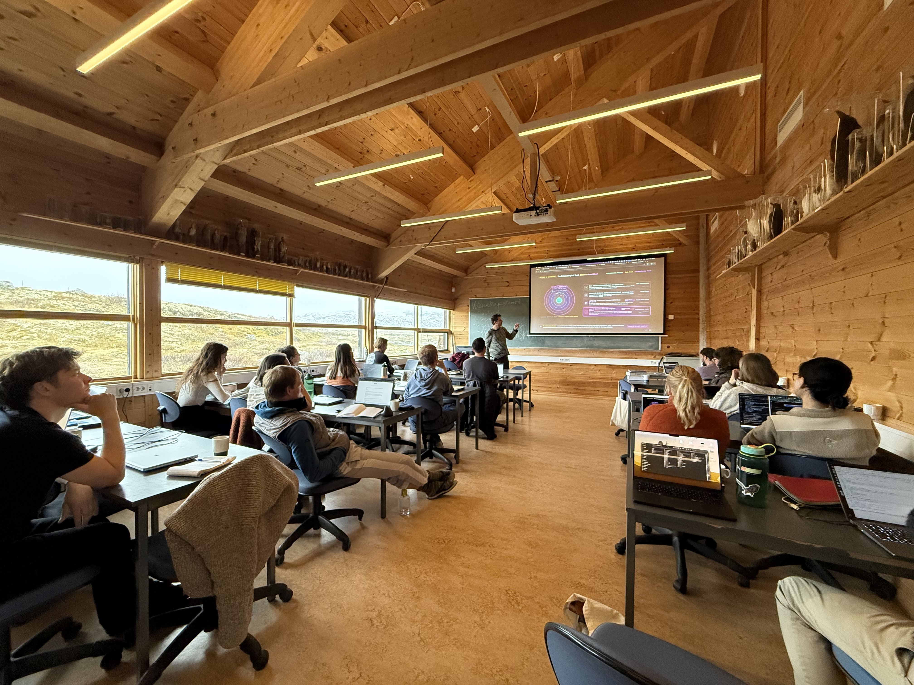{fig-alt="Students with laptops seated in a wood-panelled classroom while an instructor presents a diagram on a projector screen."}

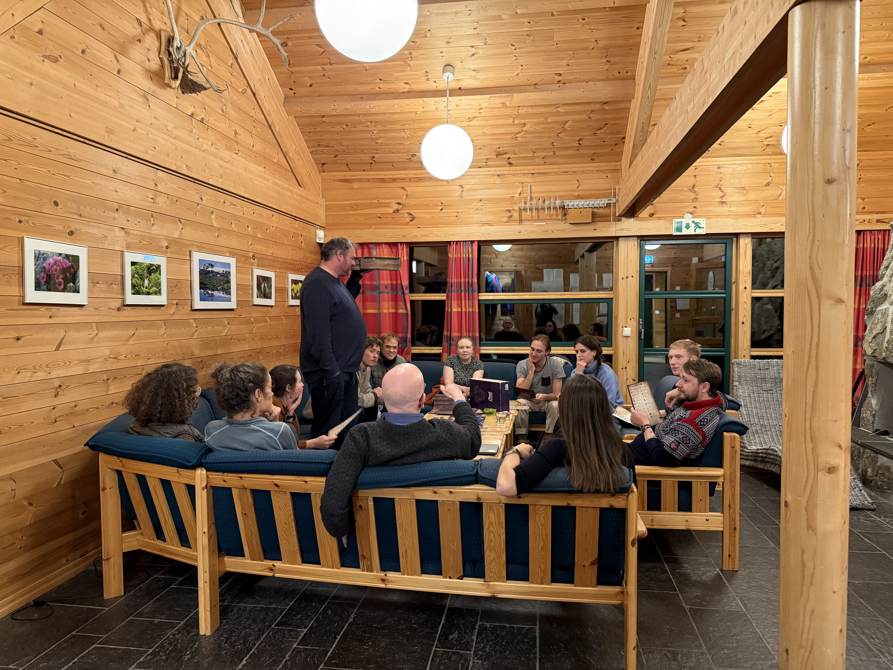{fig-alt="Course participants gathered on sofas in a lodge common room during an evening social activity."}

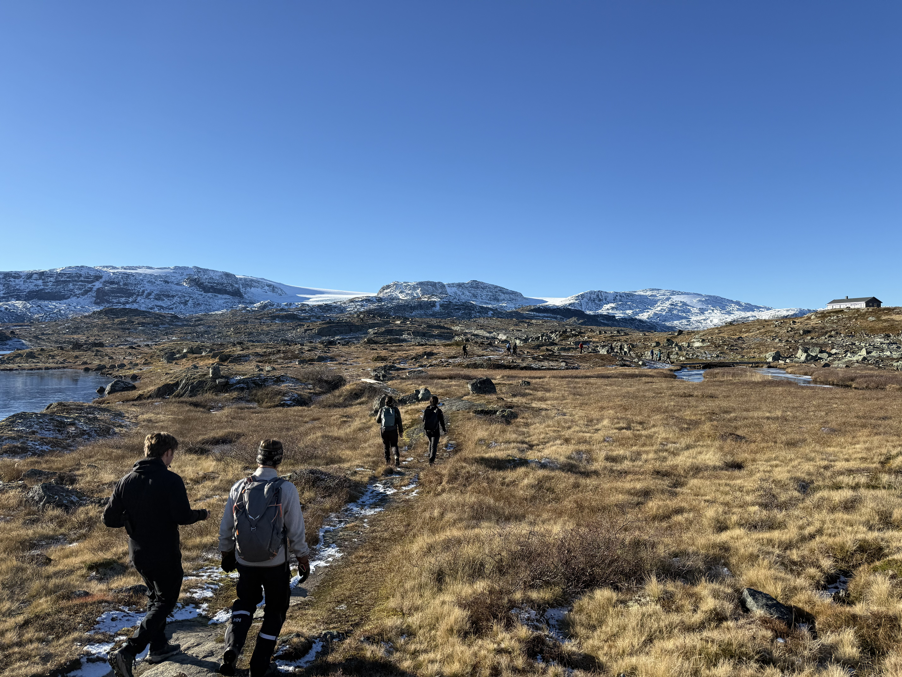{fig-alt="Hikers walking a trail through alpine grassland toward snow-capped mountains under a clear blue sky."}
:::

### Workshop - IAVS, Spain, 2026

We organized a full day workshop *Hands-on training in open and reproducible science* at the IAVS in Gijón, Spain. The aim of the workshop was to show tools for reproducible science including reproducible documents (Quarto) and version control (Git/GitHub). The workshop was aimed at early career researchers with a basic knowledge in R. We had 12 participants.

The workshop was organized by Aud H. Halbritter, Sonya Geange and Dagmar Egelkraut from the University of Bergen.

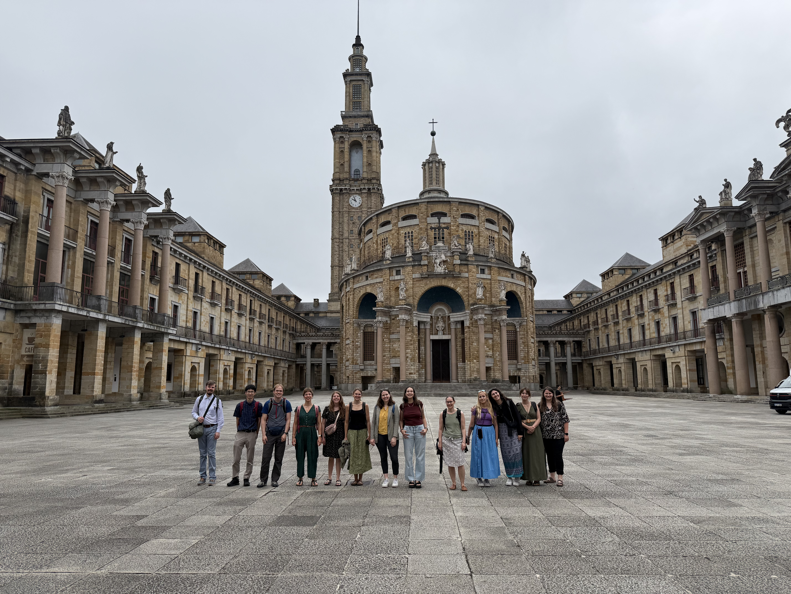{fig-alt="Thirteen workshop participants standing in a courtyard in front of the Universidad Laboral de Gijón building complex."}

### Course - Hjerkinn, 2025

The 2025 Open, Reproducible and Transparent Course in Ecology was held again at Hjerkinn between the 10th and 15th of November. This year we had 21 students participating in the course. The international group was from institutions in Norway, Sweden, Finnland, Iceland, UK, Northern Ireland, Austria, and Ghana. The teachers included experts on different topics from GBIF Norway (UiO), NTNU, NINA, and UiB.

The whole week was dedicated to teaching and learning about the data life cycle. We started with a general introduction to Open Science,tools and approaches, and continued with topics on data handling, repositories, publishing and reuse, reproducible workflows, and analysis. The course was a mix of lectures and hands-on practical exercises. The students got an introduction to GBIF, Darwin Core, and biases in GBIF data. We also covered best practice in data analysis, reporting results, and systematic reviews and meta analysis. For the first time, we also discussed using AI in data publishing and coding. Finally the students were also introduced to tools for more reproducible workflows including quarto, GitHub, and targets. In the middle of the week we took a well deserved break and went for a short hike to Vålåsjøhøe. This was essential to clear our heads and continue the data wrangling and coding for the rest of the week. On the last day, all the students had the opportunity to apply what they have learned to their own data and work.

After a whole week of discussions and coding we all left Hjerkinn satisfied. Hopefully, everybody went home with a new toolkit to apply in their daily data management and coding to support more open and reproducible ecological science.

Thank you for the wonderful week!

::: {.photo-gallery .featured}
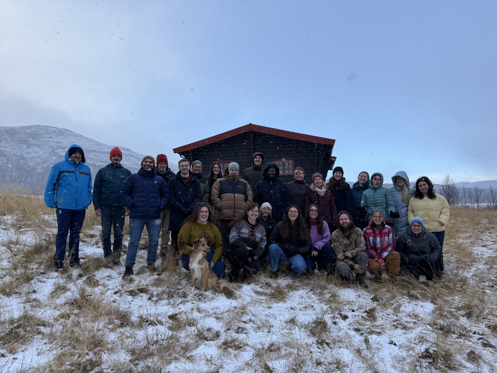{fig-alt="Teachers and students in winter clothing posing with a dog in light snow outside a wooden cabin at Hjerkinn."}
:::

::: photo-gallery
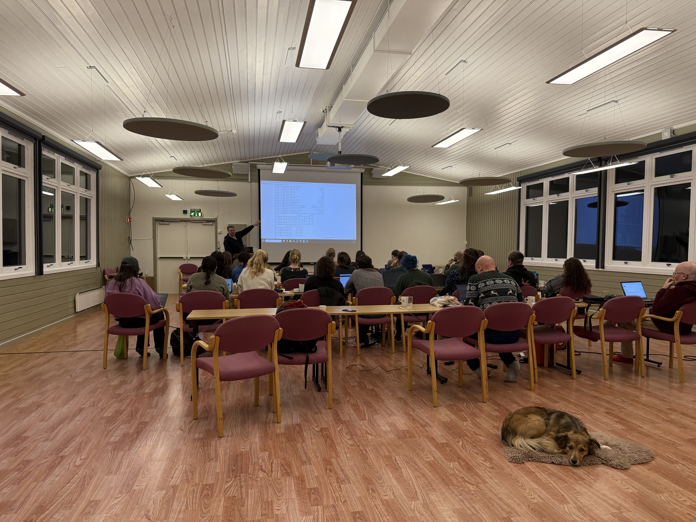{fig-alt="Students seated at tables with laptops watching a coding presentation, with a dog resting on the floor in the foreground."}

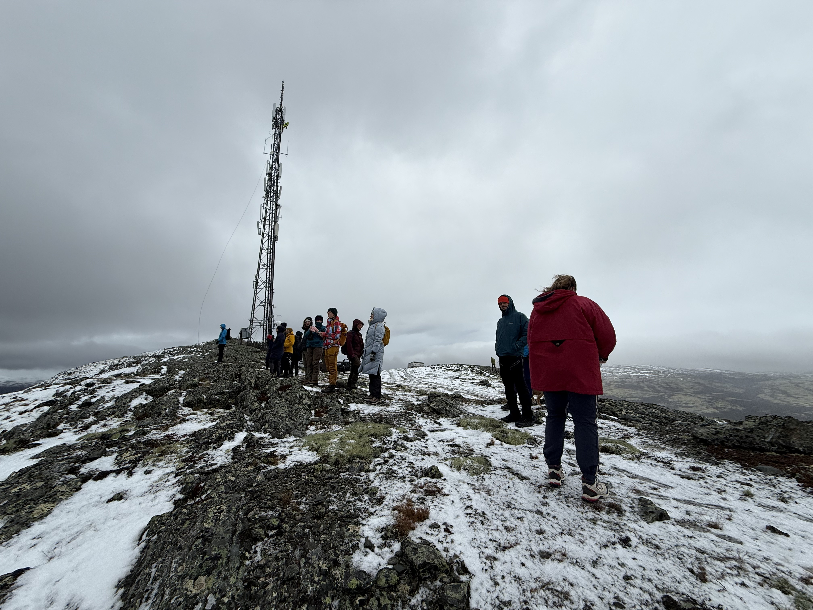{fig-alt="Course participants standing on a snowy mountain ridge overlooking a wide valley under an overcast sky."}
:::

### Course - Hjerkinn, 2024

The 2024 Open, Reproducible and Transparent Science in Ecology was held at Hjerkinn again between the 6.- 11. November. This year, we had an international group of 13 students from Scandinavia (Norway, Finland, and Denmark/Greenland), Switzerland and the UK.

The students were interested and engaged in learning how to wrangle data, write code, execute functions, and learning how to make an R package. The course curriculum also contains reproducible workflows, using tools to improve reproducibility in their own work, such as quarto, git/GitHub and targets. We had invited guest lecturers to talk about GBIF, Darwin Core data standards and what it takes to meet the FAIR data standards. One evening we conducted an exercise, where the students screened articles in ecological journals, searching for openly available data and code to reproduce the analysis. The result was eye-opening for the students in that most data was available, however the analysis could rarely be reproduced due to lack of availability of code. Mid-week, we organized a hike to Vålåsjøhøe to get some fresh are and clear our heads. After the hike, we got a presentation from Roy Andersen who works at the [Villreinsenter](https://villrein.no/norsk-villreinsenter/) at Hjerkinn. He presented the ecology and status of the reindeer in Norway and the work the Villreinsenter does to protect the reindeer. On the last day, the students got the opportunity to work on their own projects, applying new approaches they have learned. 

After five days, we left Hjerkinn tired and satisfied, full of ideas, motivation and inspiration from the new tools and skills to improve how to do science.

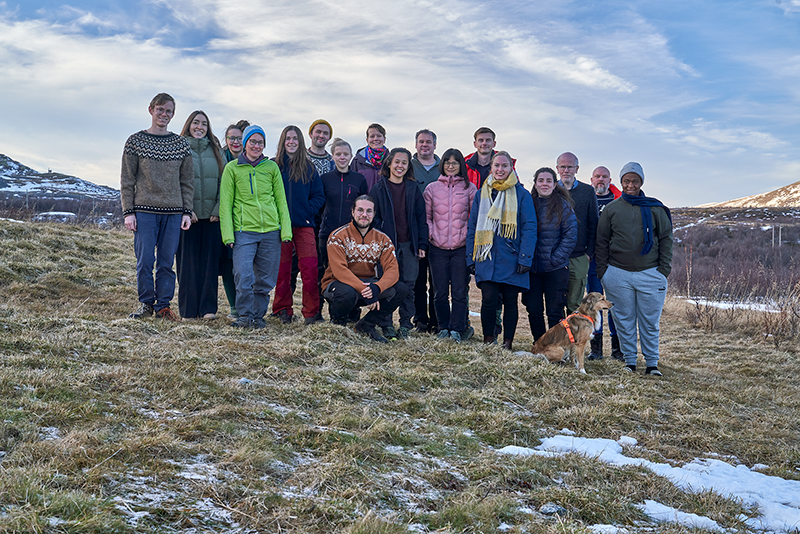{fig-alt="Teachers and students in outdoor winter clothing posing with a dog on a frosty hillside with mountains behind them." width="547"}

### Course - Hjerkinn, 2023

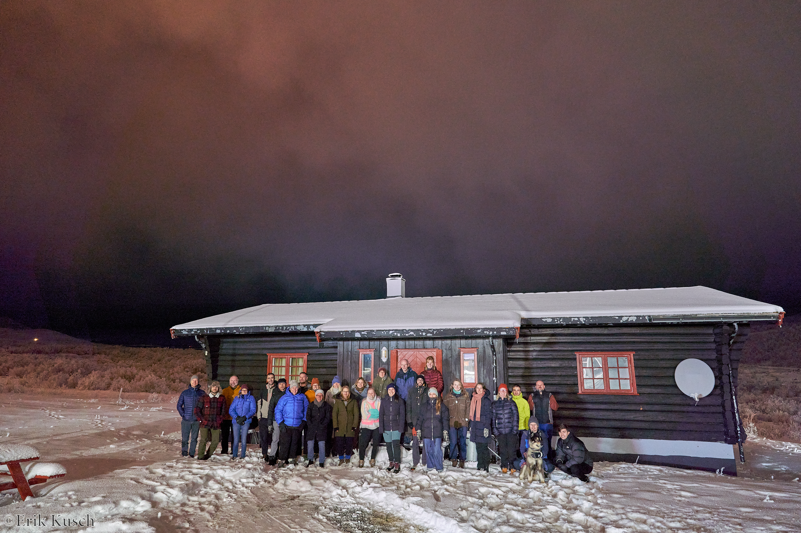{fig-alt="Teachers and students in colourful winter jackets posing at night in the snow in front of a log cabin, with a dog in the front row."}

In November 2023, the Open Science course was held at Hjerkinn, located between Oslo and Trondheim. Everybody made their way slowly up the mountain. The journey from Oslo took an hour longer, because of a missing bridge and a "bus for tog" replacement. The weather at Hjerkinn was sunny and we entered a winter wonderland. Not only the beauty took away our breath, as the temperature was far below 0 °C. An we walked though deep snow to our accommodation.

Our international students this year were from Scandinavia (Norway, and Denmark), and Europe and Asia (Belgium, Switzerland, Italy, and Thailand). This year one supervisor from a student that took the course last year attended the course to be able to keep up with their students. Also, a cat and a dog were part of the team.

Every day we quickly ran to our lecture room before freezing, as this required a few steps outside. The students were very interested and engaged and learned how to wrangle data, write code, execute functions, and even learned how to make a package. They learned about reproducible workflows, using tools to improve reproducibility in their own work, such as quarto, git/GitHub and targets. Also, they learned about GBIF, Darwin Core data standards and what it takes to meet the FAIR data standards. One evening we had a fun exercise, where we went through journals searching if the authors provided data and code for their studies and analysis. While the work was fun and the students did not want to stop, the results was disappointing, as we did not find a lot of data and code that was accessible. Mid week, we visited the [Villreinsenter](https://villrein.no/norsk-villreinsenter/) at Hjerkinn and afterwards hike through deep snow to a little top and had a deserved break.

After five days, we left Hjerkinn tired and satisfied; full of ideas, motivation and newly aquired tools and skills to improve our work and workflows.

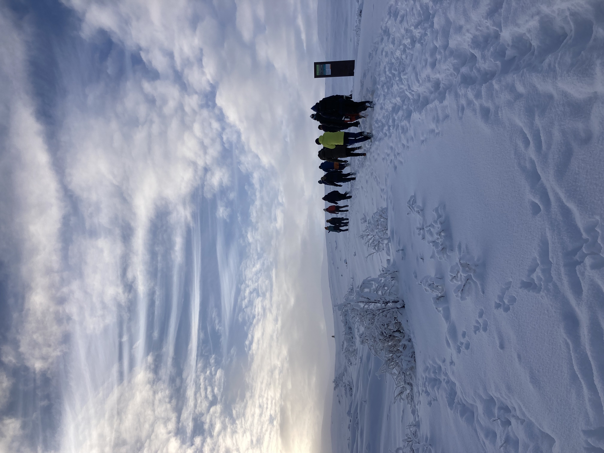{fig-alt="A line of hikers in colourful winter gear walking away across a deep-snow landscape under a bright cloudy sky."}

### Workshop - Managing Ecological Data, NØF 2023

We organized a workshop at the NØF 2023 conference at NMBU on *Managing ecological data: Best practices for data sharing and data reuse based on transparent and reproducible workflows*. The aim of the workshop was to illustrate what data management is and why it is important. We showed best practice in managing ecological data for sharing your own data, applying FAIR principles, and for reusing existing datasets. The workshop included hands-on training tools for sharing data and making reproducible documents.

The workshop was aimed at ecologists that create and/or reuse ecological data from early career researchers with little experience with data management to more experienced researchers. The hands-on training will be based on selected case studies, and implemented in statistical program R.

Organized by Aud H. Halbritter (University of Bergen), Erlend B. Nilsen (Norwegian Institute for Nature Research and Nord University, and project leader of Living Norway Ecological Data Network) and Matt Grainger (Norwegian Institute for Nature Research).

### Course - Finse Alpine Research Center, 2022

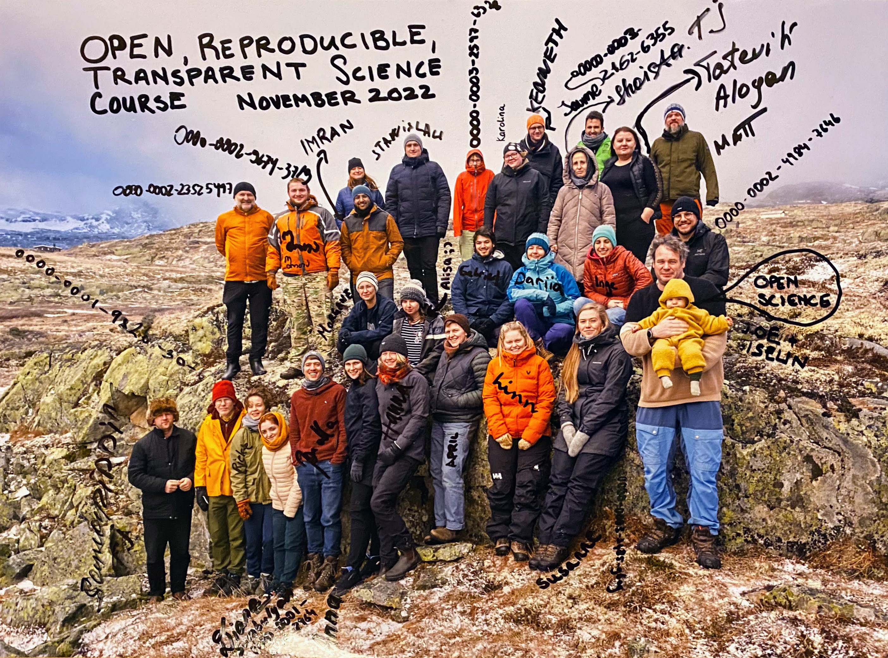{fig-alt="Annotated group photo of the 2022 Open Science course participants on rocky alpine terrain, with handwritten names and ORCID iDs beside people."}

In November, we held a course on Open, Reproducible, and Transparent Science in Ecology at the Biological Research Station at Finse. The course was a collaboration between BioCEED (University of Bergen), GBIF Norway and Living Norway with teachers from NINA, NTNU, UiO and UiB. The course was aimed for PhD students and offered hands-on training, skills and knowledge on Open Science, data collection, data handling, data standards, data repositories and publishing, reproducible workflows and best practice in data analysis.

On Monday, 14th of November a group of students and teachers made their way slowly up the mountain to Finse. The students were an international group from Scandinavia (Norway, Sweden, Denmark), Spain, Eastern Europe, Eurasia and Asia (Ukraine, Belarus, Georgia, Armenia, India, Tajikistan). It was unusually warm for the season, and there was no snow, which was lucky for those who were not prepared for the alpine environment.

While the temperature was dropping and the wind was howling, the students were wrangling data, writing code, and executing functions. They recorded frozen species and made their own data collection to understand the importance of also recording metadata (the data around the data). They learned why reproducible workflows, using tools such as quarto, git/GitHub and targets can benefit your future self, increase collaboration and make your research more robust. And finally, they learned about GBIF, Darwin Core data standards and what it takes to meet the FAIR data standards.

Five days later, loaded with a toolbox full of new skills the students made their way slowly down the mountain. They were happy and tired and showed a strong motivation to apply the new skills and knowledge in their own work and spread the word about Open Science among their colleagues and supervisors.