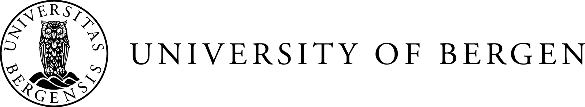
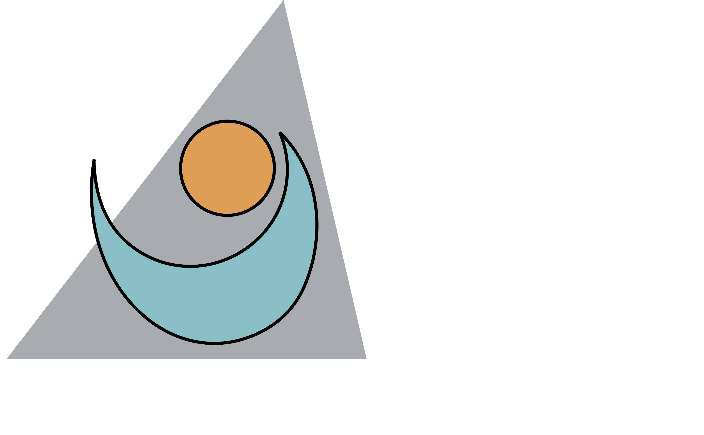
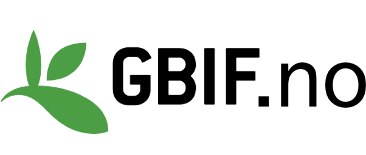
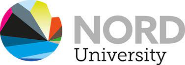
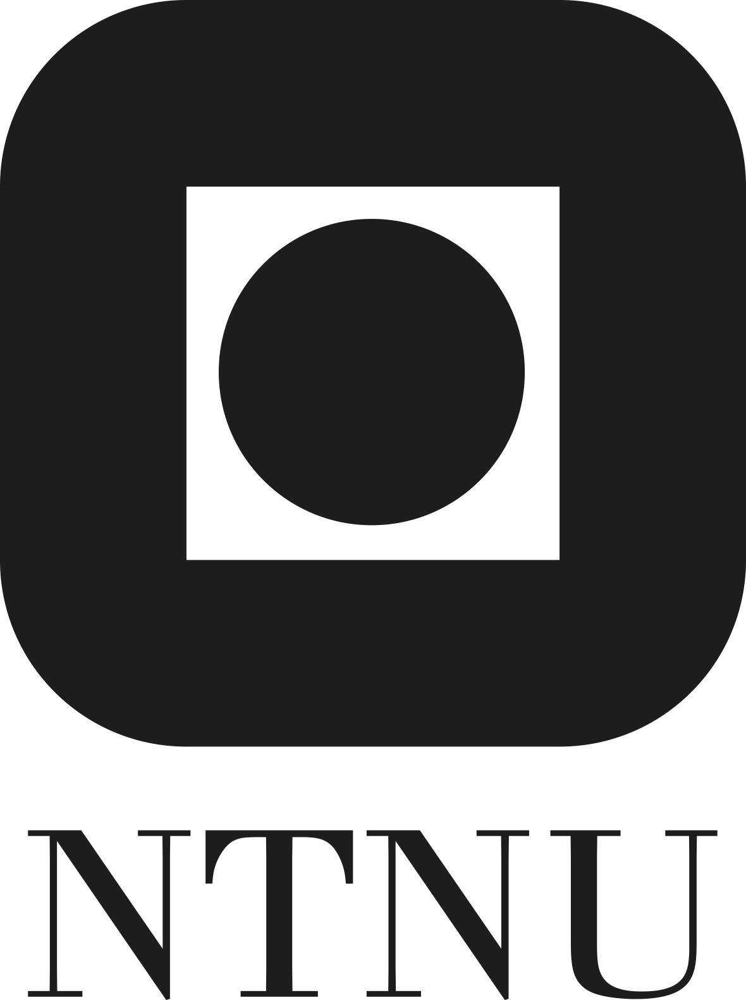
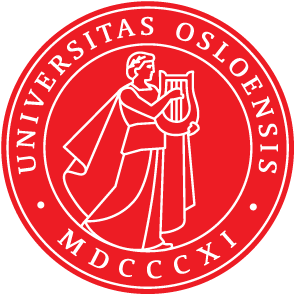

## The aim

[We](about_us.qmd) are a group of ecologists and statisticians in Norway who want to increase the awareness of Open Science principles in our community and provide education and teaching material on open and reproducible science in ecology.

## What we do

We organize [courses and workshops](courses.qmd) on Open Science for ecologists.

We openly provide the [teaching material](course_content.qmd) for the Open Science course.

We develop [tools](course_content.qmd#tools-and-approaches) to facilitate Open Science practices in our community.

### The Open Science course - (Star wars edition)

Click through this short presentation to see what Living Norway Open Science Training is about. Use the arrow keys or click the sides of the slides to move forward and back. [Open fullscreen](https://open-science-course.github.io/OS-training-material/general/lunch_seminar_starwars.html).

```{=html}
<style>
.deck-embed {
  margin: 1rem 0 1.6rem;
  border-radius: 12px;
  overflow: hidden;
  background: #000;
  box-shadow: 0 4px 18px rgba(36, 49, 64, 0.22);
  aspect-ratio: 16 / 9;
  max-height: min(70vh, 640px);
}
.deck-embed iframe {
  display: block;
  width: 100%;
  height: 100%;
  border: 0;
  background: #000;
}
</style>
<div class="deck-embed">
  <iframe
    title="Living Norway Open Science Training lunch seminar presentation"
    src="https://open-science-course.github.io/OS-training-material/general/lunch_seminar_starwars.html"
    loading="lazy"
    allow="fullscreen"
    allowfullscreen></iframe>
</div>
```

## Acknowledgements

Open Science Training is part of the [Living Norway Ecological Data Network](https://livingnorway.no/) and a collaboration with the [University of Bergen](https://www.uib.no/en), [Nord University](https://www.nord.no/en), [GBIF Norway](https://www.gbif.no/), [Norwegian University of Science and Technology](https://www.ntnu.edu/), [University of Oslo](https://www.uio.no/english/) and [Norwegian Institute for Nature Research](https://www.nina.no/en).

```{=html}
<style>
.partners {
  display: flex;
  flex-wrap: wrap;
  justify-content: center;
  align-items: center;
  gap: 1.35rem 1.8rem;
  margin: 1.4rem 0 0.3rem;
}
.partners p,
.partners figure,
.partners .quarto-figure {
  margin: 0;
}
.partners img {
  display: block;
  height: 4.4rem;
  width: auto;
  max-width: 100%;
}
.partners img.logo-wide {
  height: 3.15rem;
}
.partners img.logo-tall {
  height: 5.4rem;
}
</style>
```

::: partners
{.logo-wide fig-alt="Living Norway Ecological Data Network"}

{.logo-wide fig-alt="University of Bergen"}

{fig-alt="Norwegian Institute for Nature Research"}

{fig-alt="GBIF Norway"}

{.logo-wide fig-alt="Nord University"}

{.logo-tall fig-alt="NTNU"}

{.logo-tall fig-alt="University of Oslo"}
:::

## License

The material on this webpage is licensed under a Creative Commons Attribution 4.0 International (CC BY 4.0). For more information see [creativecommons.org](https://creativecommons.org/licenses/by/4.0/).